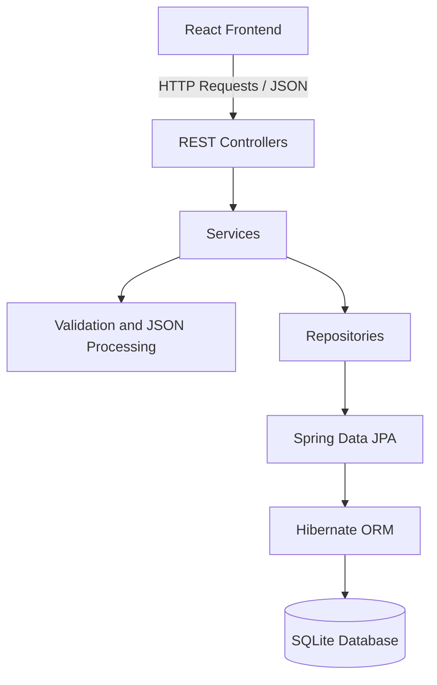
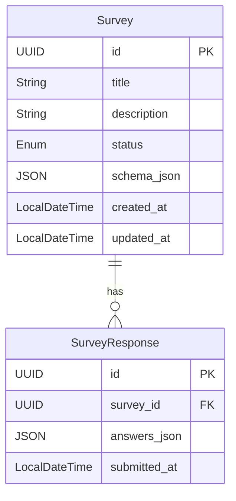
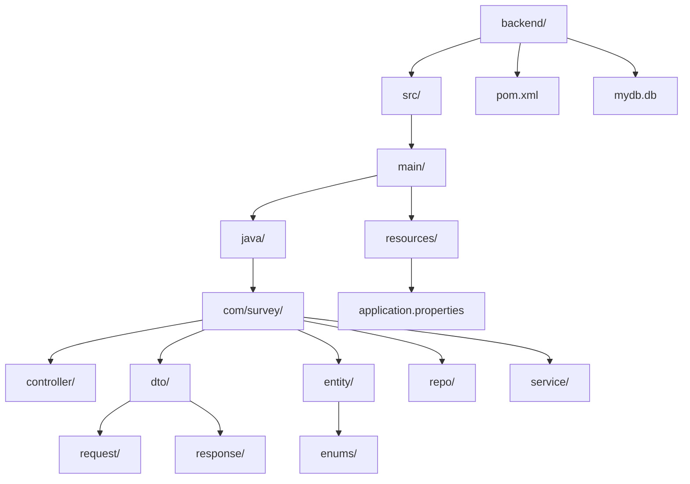

# Survey Management System – Backend Documentation

## 1. Project Overview

The Survey Management System is a full-stack application designed to create and manage surveys, collect responses, and analyze submitted data.

The backend is developed using Java and Spring Boot. It provides REST APIs that allow the frontend application to communicate with the database and perform survey-related operations.

The backend handles survey creation, updating, publishing, closing, response submission, answer validation, response retrieval, analytics, and CSV export.

The application uses SQLite as its database during development.

## 2. Technology Stack

| Technology         | Purpose                                   |
| ------------------ | ----------------------------------------- |
| Java 21            | Backend programming language              |
| Spring Boot        | Backend application framework             |
| Spring Web         | REST API development                      |
| Spring Data JPA    | Database access and repository management |
| Hibernate          | Object-relational mapping                 |
| SQLite             | Database management                       |
| Maven              | Dependency management and project build   |
| Jackson            | JSON processing and serialization         |
| Jakarta Validation | Request validation                        |

## 3. Backend Architecture

The backend follows a layered architecture. Each layer has a separate responsibility, which makes the application easier to maintain, test, and extend.

### Architecture Overview





### Main Layers

**Controller Layer**

The controller layer handles incoming HTTP requests and exposes the application's REST endpoints. It receives request data, calls the appropriate service methods, and returns responses to the frontend.

**Service Layer**

The service layer contains the application's business logic. It manages survey operations, validates submitted answers, processes responses, retrieves analytics, and prepares CSV exports.

**Repository Layer**

The repository layer communicates with the database through Spring Data JPA. It provides methods for saving, retrieving, counting, and deleting surveys and responses.

**Entity Layer**

The entity classes represent the database tables. The main entities are `Survey` and `SurveyResponse`.

**DTO Layer**

Data Transfer Objects (DTOs) define the request and response structures used by the API. They help separate API data from database entities.

**Validation and JSON Processing**

The application uses validation logic to check submitted answers against the survey question schema. JSON processing is handled through the application's JSON service.

## 4. Database Design

The backend currently uses two main entities:

1. Survey
2. SurveyResponse

### 4.1 Survey Entity

The `Survey` entity represents a survey created by an administrator.

| Field            | Description                                            |
| ---------------- | ------------------------------------------------------ |
| `id`             | Unique survey identifier stored as a UUID              |
| `title`          | Survey title                                           |
| `description`    | Description of the survey                              |
| `status`         | Current survey status                                  |
| `currentVersion` | Version field maintained by the entity                 |
| `createdAt`      | Date and time when the survey was created              |
| `updatedAt`      | Date and time when the survey was last updated         |
| `schemaJson`     | Survey questions and configuration stored as JSON text |

The survey entity supports the following operations:

- Updating survey information.
- Publishing a survey.
- Closing a survey.
- Automatically maintaining creation and modification timestamps.

### 4.2 Survey Status

A survey can have one of three statuses:

| Status      | Description                                                               |
| ----------- | ------------------------------------------------------------------------- |
| `DRAFT`     | The survey is being prepared and is not available for public submissions. |
| `PUBLISHED` | The survey is available for respondents.                                  |
| `CLOSED`    | The survey is closed and no longer accepts new responses.                 |

The status determines which operations are available during the survey lifecycle.

### 4.3 SurveyResponse Entity

The `SurveyResponse` entity stores answers submitted by respondents.

| Field         | Description                                                     |
| ------------- | --------------------------------------------------------------- |
| `id`          | Unique response identifier stored as a String containing a UUID |
| `survey`      | Reference to the survey associated with the response            |
| `answersJson` | Submitted answers stored as JSON text                           |
| `submittedAt` | Date and time when the response was submitted                   |

Each response belongs to one survey through a `ManyToOne` relationship.

A database index is maintained on the `survey_id` column to support efficient response retrieval.

### 4.4 Entity Relationship





One survey can contain multiple submitted responses, while each response belongs to one survey.

## 5. Survey Schema and Question Types

Survey questions are stored in the `schemaJson` field of the Survey entity.

This approach allows each survey to have its own set of questions without requiring a separate database table for every question.

The application supports these question types:

- `TEXT` – Allows respondents to enter text.
- `SINGLE_CHOICE` – Allows respondents to select one option.
- `MULTI_SELECT` – Allows respondents to select multiple options.
- `RATING` – Allows respondents to provide a numerical rating.

Question configuration can include the following properties:

| Property    | Description                                          |
| ----------- | ---------------------------------------------------- |
| `id`        | Unique question identifier                           |
| `title`     | Question text                                        |
| `type`      | Question type                                        |
| `required`  | Determines whether an answer is mandatory            |
| `order`     | Controls question sequence                           |
| `options`   | Available choices for applicable question types      |
| `condition` | Optional configuration for conditional display logic |

### Example Survey Schema

```json
{
  "questions": [
    {
      "id": "question-1",
      "title": "How satisfied are you with our service?",
      "type": "RATING",
      "required": true,
      "order": 1,
      "options": []
    },
    {
      "id": "question-2",
      "title": "What can we improve?",
      "type": "TEXT",
      "required": false,
      "order": 2,
      "options": []
    }
  ]
}
```

The example illustrates the structure of a survey containing multiple questions. Actual question identifiers are determined by the application.

## 6. REST API Documentation

The backend exposes REST endpoints for survey administration and public participation.

**Local API Base URL**

```text
http://localhost:5454/api
```

### 6.1 Survey Administration APIs

| HTTP Method | Endpoint                               | Description                    |
| ----------- | -------------------------------------- | ------------------------------ |
| POST        | `/admin/surveys`                       | Create a new survey            |
| GET         | `/admin/surveys`                       | Retrieve all surveys           |
| GET         | `/admin/surveys/{id}`                  | Retrieve a survey by ID        |
| PUT         | `/admin/surveys/{id}`                  | Update survey information      |
| PATCH       | `/admin/surveys/{id}/publish`          | Publish a survey               |
| PATCH       | `/admin/surveys/{id}/close`            | Close a survey                 |
| DELETE      | `/admin/surveys/{id}`                  | Delete a survey                |
| GET         | `/admin/surveys/{id}/responses`        | Retrieve submitted responses   |
| GET         | `/admin/surveys/{id}/analytics`        | Retrieve survey analytics      |
| GET         | `/admin/surveys/{id}/responses/export` | Export responses as a CSV file |

### 6.2 Public Survey APIs

| HTTP Method | Endpoint                         | Description                 |
| ----------- | -------------------------------- | --------------------------- |
| GET         | `/public/surveys/{id}`           | Retrieve a published survey |
| POST        | `/public/surveys/{id}/responses` | Submit a survey response    |

### 6.3 Example: Create a Survey

```http
POST /api/admin/surveys
Content-Type: application/json
```

The request contains the survey title, description, and question schema.

### 6.4 Example: Submit a Survey Response

```http
POST /api/public/surveys/{surveyId}/responses
Content-Type: application/json
```

Example request body:

```json
{
  "answers": {
    "question-1": 5,
    "question-2": "The service was helpful."
  }
}
```

The answer keys must match the question identifiers defined in the survey schema.

When a valid response is submitted, the backend saves it and returns a response DTO with HTTP status `201 Created`.

## 7. Survey Creation and Management

The survey management functionality is implemented in the service layer.

The general survey lifecycle is:

1. An administrator creates a survey.
2. The backend stores the survey information and question schema.
3. The survey remains in `DRAFT` status.
4. The administrator publishes the survey.
5. Respondents can access the published survey and submit answers.
6. The administrator closes the survey when response collection is finished.

The backend provides separate operations for publishing and closing surveys so that survey status is managed explicitly.

## 8. Response Submission and Validation

Response submission is handled by `ResponseService`.

Before storing a response, the backend performs several operations:

1. Retrieves the requested survey in its published state.
2. Reads the question schema stored in the database.
3. Validates submitted answers using `ResponseAnswerValidator`.
4. Converts the answers into JSON text using `JsonService`.
5. Creates a `SurveyResponse` entity.
6. Saves the response in SQLite.
7. Returns a response DTO to the frontend.

This validation process helps ensure that submitted answers match the survey's question configuration.

The backend also checks the survey's publishing status before accepting submissions.

## 9. Retrieving Survey Responses

Administrators can retrieve all submitted responses for a particular survey through:

```http
GET /api/admin/surveys/{surveyId}/responses
```

The repository method used for retrieving responses is:

```java
findBySurvey_IdOrderBySubmittedAtDesc(UUID surveyId)
```

This method retrieves responses associated with a survey and sorts them by submission time, with the newest responses appearing first.

The stored answers are maintained as JSON text and are used by the response service and frontend to display submitted information.

## 10. Survey Analytics

The backend provides an analytics endpoint:

```http
GET /api/admin/surveys/{surveyId}/analytics
```

The analytics functionality provides information that helps administrators understand survey participation and submitted answers.

The intended analytics include:

- Total number of submitted responses.
- Number of answers for individual questions.
- Option counts for single-choice questions.
- Option counts for multi-select questions.
- Average rating for rating questions.
- Submitted text answers for open-ended questions.

The analytics API allows the frontend to display survey results in a more understandable format.

## 11. CSV Response Export

The application includes a CSV export feature so that administrators can download submitted survey data after closing a survey.

**API Endpoint**

```http
GET /api/admin/surveys/{surveyId}/responses/export
```

### Export Process

1. The administrator closes a survey.
2. The frontend provides the download option for the closed survey.
3. The backend receives the export request.
4. The service retrieves the survey and checks its status.
5. If the survey is not closed, the export request is rejected.
6. If the survey is closed, the backend retrieves its questions and submitted responses.
7. The service generates CSV content and returns it as a downloadable file.

### CSV Structure

The exported file contains:

- A submission date and time column.
- One column for each survey question.
- One row for each submitted response.

Example:

| Submitted At     | How satisfied are you? | What can we improve? |
| ---------------- | ---------------------: | -------------------- |
| 2026-11-18T10:30 |                      5 | Faster response time |
| 2026-11-18T11:15 |                      4 | More features        |
| 2026-11-18T12:00 |                      3 | Better navigation    |

### CSV Handling

The export implementation handles common CSV formatting requirements:

- UTF-8 encoding.
- A UTF-8 byte-order mark for spreadsheet compatibility.
- Quotation marks around CSV cell values.
- Escaping quotation marks contained in answers.
- Commas and line breaks within submitted text.
- Multiple selected options combined into a single cell.

The backend enforces the closed-survey restriction. A draft or published survey should not be exportable.

## 12. Database Configuration

The backend uses SQLite as its database.

The following configuration is used during local development:

```properties
spring.application.name=survey-backend

# Backend server port
server.port=5454

# SQLite database configuration
spring.datasource.url=jdbc:sqlite:mydb.db

# Hibernate dialect
spring.jpa.database-platform=org.hibernate.community.dialect.SQLiteDialect

# Automatically update the database schema during development
spring.jpa.hibernate.ddl-auto=update
```

The database file is named `mydb.db`.

The current configuration allows Hibernate to update the database schema during development. For production environments, a dedicated database migration strategy and regular backups should be considered.

## 13. Running the Backend Locally

### Prerequisites

Before running the backend, ensure that the following tools are installed:

- Java 21
- Maven
- Git

### Setup Instructions

**Step 1: Clone the repository**

```bash
git clone <repository-url>
```

**Step 2: Navigate to the backend directory**

```bash
cd survey-management-system/backend
```

Adjust the directory name if your repository uses a different structure.

**Step 3: Run the Spring Boot application**

Using Maven:

```bash
mvn spring-boot:run
```

Or using the Maven wrapper:

```bash
./mvnw spring-boot:run
```

**Step 4: Verify the application**

The backend should start on:

```text
http://localhost:5454
```

The API base URL is:

```text
http://localhost:5454/api
```

You can test the REST endpoints using Postman or the frontend application.

## 14. Current Scope and Limitations

The backend focuses on survey management, response collection, and data analysis.

The following features should not be considered implemented unless they are added separately:

- User authentication and role-based authorization.
- Rate limiting and spam protection.
- Partial response saving.
- Full survey version history.
- Automated database backup and recovery.

The `/admin` URL prefix organizes administrative endpoints but does not itself provide authentication or authorization. Appropriate security controls are necessary before exposing administrative APIs publicly.

## 15. Backend Project Structure

The backend follows a package structure similar to the following:





The exact package contents may vary as the application develops.

## 16. Summary

The backend provides the core functionality required by the Survey Management System.

It uses Spring Boot and a layered architecture to manage survey creation, lifecycle operations, response validation, data persistence, analytics, and CSV export.

The use of JSON-based survey schemas provides flexibility when creating surveys with different question types, while the relationship between surveys and submitted responses keeps the collected data organized.

This backend structure provides a foundation for maintaining and extending the application as additional requirements are introduced.

---
