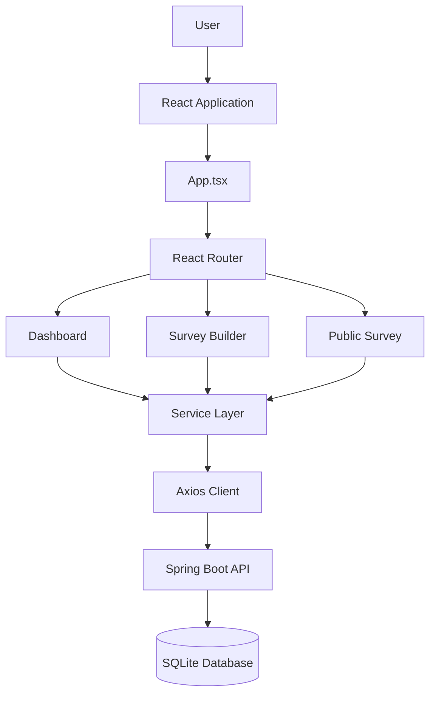
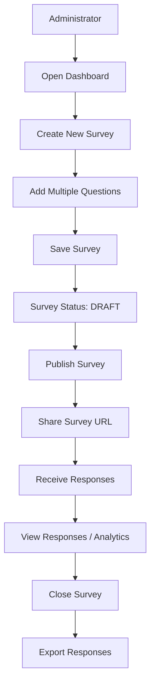
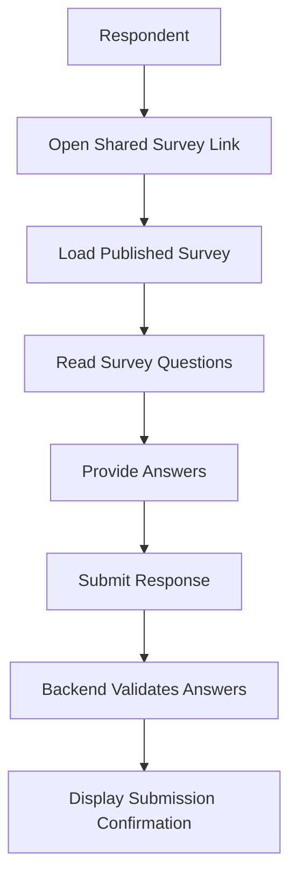

# Survey Management System – Frontend Documentation

## 1. Project Overview

The Survey Management System frontend provides a user-friendly interface for creating surveys, managing published surveys, collecting responses, and reviewing survey results.

It is developed using React and TypeScript. The frontend communicates with the Spring Boot backend through REST APIs and uses Axios to handle HTTP requests.

The application provides two main experiences:

- **Survey administration:** Administrators can create, manage, publish, close, and review surveys.
- **Public survey participation:** Respondents can open shared survey links, answer questions, and submit their responses.

The interface is organized into reusable components and separate pages to keep the application maintainable and easy to extend.

## 2. Technology Stack

| Technology | Purpose |
|---|---|
| React | Building the user interface |
| TypeScript | Type safety and structured development |
| Vite | Frontend development server and build tool |
| React Router DOM | Navigation and page routing |
| Axios | Communication with backend REST APIs |
| CSS | Styling and responsive layouts |
| JavaScript / ES6+ | Application logic |

## 3. Frontend Architecture

The frontend follows a component-based structure. Pages are responsible for individual application screens, reusable components handle specific interface elements, and service files manage communication with the backend.

### Architecture Overview





### Main Frontend Layers

**Pages**

Pages represent the main screens of the application, such as the dashboard, survey builder, public survey, response viewer, and analytics page.

**Components**

Reusable components manage specific interface elements. For example, the question editor is used to configure questions while building a survey.

**Services**

Service files contain functions for communicating with the backend. This keeps API calls separate from the page components.

**Types**

TypeScript interfaces and types define the structure of surveys, questions, responses, and analytics data.

**Styling**

CSS files are used to style individual pages and components. This keeps presentation separate from application logic.

## 4. Application Structure

The frontend uses React Router DOM to navigate between different application pages.

The main routes are:

| Route | Page | Purpose |
|---|---|---|
| `/` | Dashboard | Manage and view surveys |
| `/surveys/create` | SurveyBuilder | Create a new survey |
| `/surveys/:id` | PublicSurvey | Open and complete a survey |
| `/surveys/:id/responses` | SurveyResponses | View submitted responses |
| `/surveys/:id/analytics` | SurveyAnalytics | Review survey analytics |

The survey ID is passed through the URL so that the application can retrieve the relevant survey and its associated data.

## 5. Main Application Pages

### 5.1 Dashboard

The dashboard is the main administration page of the application.

It provides an overview of the surveys created by the administrator and allows them to manage the survey lifecycle.

Main functionality includes:

- Displaying all available surveys.
- Showing the total number of surveys.
- Displaying counts for draft, published, and closed surveys.
- Navigating to the survey creation page.
- Publishing draft surveys.
- Closing published surveys.
- Deleting surveys.
- Displaying shareable survey URLs for published surveys.
- Copying survey links to the clipboard.
- Navigating to submitted responses.
- Viewing survey analytics.

The dashboard retrieves survey information from the backend and updates the interface after survey operations.

### 5.2 Survey Builder

The Survey Builder is used to create surveys with multiple questions.

Administrators can configure the survey title, description, and question structure before saving it.

Main functionality includes:

- Entering a survey title and description.
- Adding multiple questions.
- Editing existing questions.
- Removing questions.
- Reordering questions.
- Selecting question types.
- Configuring available options for choice-based questions.
- Marking questions as required or optional.
- Saving the survey through the backend API.

The survey schema is prepared in the frontend and submitted to the backend as part of the survey creation request.

### 5.3 Question Editor

The `QuestionEditor` component manages the configuration of individual questions.

It is designed as a reusable component so that the Survey Builder can handle multiple questions without repeating the same interface logic.

Supported question types include:

| Question Type | Frontend Input |
|---|---|
| `TEXT` | Text input or textarea |
| `SINGLE_CHOICE` | Radio buttons |
| `MULTI_SELECT` | Checkboxes |
| `RATING` | Rating selection from 1 to 5 |

The question editor allows administrators to update question text, type, required status, and available options where applicable.

### 5.4 Public Survey

The Public Survey page allows respondents to access a survey using its shared URL.

The page retrieves survey information from the public API and displays the questions according to their configured types.

Main functionality includes:

- Loading a survey using its ID.
- Displaying the survey title and description.
- Rendering multiple questions.
- Supporting text responses.
- Supporting single-choice selections.
- Supporting multiple selections.
- Supporting rating questions.
- Checking required questions before submission.
- Submitting answers to the backend.
- Displaying a successful submission message.

Respondents do not need to navigate through the administration dashboard to access a published survey. They can open the shared survey URL directly.

### 5.5 Survey Responses

The Survey Responses page allows administrators to review submitted responses for a particular survey.

The page retrieves both the survey information and its associated responses from the backend.

Main functionality includes:

- Loading survey details.
- Retrieving all submitted responses.
- Displaying submission information.
- Showing answers against their corresponding questions.
- Handling different answer formats, including text, ratings, and multiple selections.

Responses are displayed separately so administrators can review individual submissions.

### 5.6 Survey Analytics

The Survey Analytics page provides an overview of the collected survey data.

It retrieves analytics information from the backend and presents the results in a readable format.

The analytics page is designed to display:

- Total submitted responses.
- Question-wise answer counts.
- Single-choice option distribution.
- Multi-select option distribution.
- Average ratings.
- Text responses.

Visual indicators and percentage bars help administrators understand how respondents answered each question.

Analytics are retrieved for a specific survey using its ID.

## 6. API Integration

The frontend communicates with the Spring Boot backend using Axios.

The API communication logic is maintained separately from the page components.

### 6.1 Environment Configuration

The backend API URL is configured through a Vite environment variable.

Example `.env` file:

```env
VITE_API_BASE_URL=http://localhost:5454/api
```

This allows the API URL to be changed without modifying the service implementation.

After changing environment variables, restart the Vite development server.

### 6.2 Axios Configuration

The Axios client is configured in:

```text
src/services/api.ts
```

Example implementation:

```typescript
import axios from "axios";

const api = axios.create({
  baseURL: import.meta.env.VITE_API_BASE_URL,
  timeout: 10000,
  headers: {
    "Content-Type": "application/json",
  },
});

export default api;
```

The configured Axios instance is reused by the service functions to communicate with the backend.

### 6.3 Survey Service

The survey service is maintained in:

```text
src/services/surveyService.ts
```

It contains functions for performing survey-related API operations.

These include:

- Retrieving all surveys.
- Creating a survey.
- Retrieving an individual survey.
- Updating survey information.
- Publishing a survey.
- Closing a survey.
- Deleting a survey.
- Retrieving a public survey.
- Submitting a survey response.
- Retrieving survey responses.
- Retrieving survey analytics.

Centralizing API operations in one service file makes the code easier to maintain and reduces duplicate request logic across pages.

## 7. TypeScript Data Models

The frontend uses TypeScript interfaces to define the structure of application data.

The main type definitions are maintained in:

```text
src/types/survey.ts
```

Important types include:

### QuestionType

Defines the supported question types:

```typescript
export type QuestionType =
  | "TEXT"
  | "SINGLE_CHOICE"
  | "MULTI_SELECT"
  | "RATING";
```

### SurveyStatus

Defines the possible survey statuses:

```typescript
export type SurveyStatus =
  | "DRAFT"
  | "PUBLISHED"
  | "CLOSED";
```

### SurveyQuestion

Represents an individual survey question.

It contains information such as the question ID, title, type, required status, order, available options, and optional condition configuration.

### SurveySchema

Represents the collection of questions associated with a survey.

### Survey

Represents the survey information retrieved from the backend, including its ID, title, description, schema, status, and timestamps.

### SubmitResponseRequest

Defines the structure of the data submitted by respondents.

### SurveyResponse

Represents a submitted response, including its ID, associated survey, answers, and submission timestamp.

### SurveyAnalytics

Defines the structure used to display survey analytics, including total responses and question-level results.

Using TypeScript types helps maintain consistency between frontend data structures and backend API responses.

## 8. Survey Workflow

The application follows a straightforward workflow for survey creation and participation.

### Survey Administration Workflow





### Respondent Workflow





The frontend handles the user interaction, while the backend validates and stores the submitted information.

## 9. User Interface and Styling

The application uses CSS for page-level and component-level styling.

Separate CSS files help keep the visual presentation organized.

The frontend includes styling for:

- Dashboard layout and statistics cards.
- Survey cards and status indicators.
- Survey creation forms.
- Question editors.
- Public survey forms.
- Response displays.
- Analytics sections.
- Buttons, input fields, and error messages.

The interface also includes loading, error, empty, and successful submission states where applicable.

Responsive styles are used to improve the layout across different screen sizes. The application should be checked on mobile, tablet, and desktop displays before deployment.

## 10. Running the Frontend Locally

### Prerequisites

Make sure the following tools are installed:

- Node.js.
- npm.
- Git.

The backend should also be running when testing features that require API communication.

### Setup Instructions

**Step 1: Clone the repository**

```bash
git clone <repository-url>
```

**Step 2: Navigate to the frontend directory**

```bash
cd survey-management-system/frontend
```

Adjust the directory name to match the actual repository.

**Step 3: Install dependencies**

```bash
npm install
```

**Step 4: Configure the environment variable**

Create a `.env` file in the frontend project root:

```env
VITE_API_BASE_URL=http://localhost:5454/api
```

**Step 5: Start the development server**

```bash
npm run dev
```

Vite will display the local development URL in the terminal.

During development, the application was configured to run at:

```text
http://localhost:5173
```

The actual port may differ depending on the Vite configuration and port availability.

## 11. Current Scope and Limitations

The frontend focuses on the survey creation, participation, administration, and response review workflows.

The following items should not be considered implemented unless added separately:

- User login and authentication screens.
- Role-based access management.
- Partial response saving.
- Advanced survey scheduling.
- Advanced survey customization and themes.
- Full survey version history.

The application currently uses URL-based survey identification. Authentication and authorization should be implemented in the backend before exposing administrative functionality publicly.

Conditional question configuration may be represented in the TypeScript data model, but conditional question display should only be considered complete after the rendering and answer-validation behaviour has been implemented and tested.

## 12. Frontend Project Structure

The frontend follows a structure similar to the following:

```text
frontend/
├── public/
├── src/
│   ├── components/
│   │   └── survey/
│   │       └── QuestionEditor.tsx
│   │
│   ├── pages/
│   │   ├── Dashboard.tsx
│   │   ├── Dashboard.css
│   │   ├── SurveyBuilder.tsx
│   │   ├── PublicSurvey.tsx
│   │   ├── PublicSurvey.css
│   │   ├── SurveyResponses.tsx
│   │   ├── SurveyResponses.css
│   │   ├── SurveyAnalytics.tsx
│   │   └── SurveyAnalytics.css
│   │
│   ├── services/
│   │   ├── api.ts
│   │   └── surveyService.ts
│   │
│   ├── types/
│   │   └── survey.ts
│   │
│   ├── App.tsx
│   ├── main.tsx
│   └── index.css
│
├── .env
├── package.json
├── tsconfig.json
└── vite.config.ts
```

The exact filenames and folder structure may vary slightly depending on the current project files.

## 13. Summary

The frontend provides the interface through which administrators manage surveys and respondents submit their answers.

React and TypeScript are used to build reusable components and maintain structured application data. React Router handles navigation, while Axios provides communication with the Spring Boot backend.

The application supports the complete survey workflow, from creating and publishing surveys to collecting responses and reviewing analytics.

The component-based structure also provides a foundation for adding further functionality without unnecessarily complicating the existing codebase.

---
