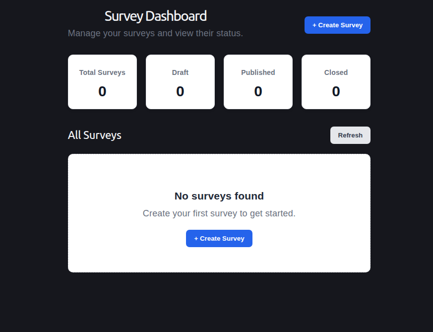
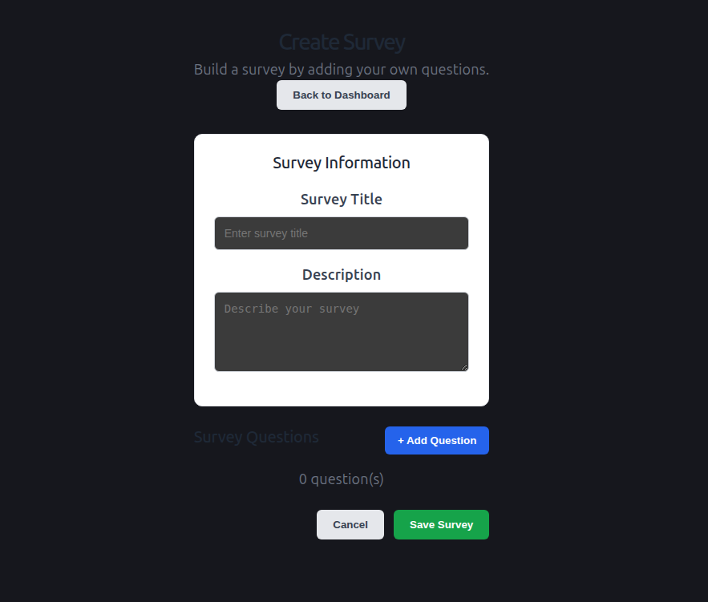
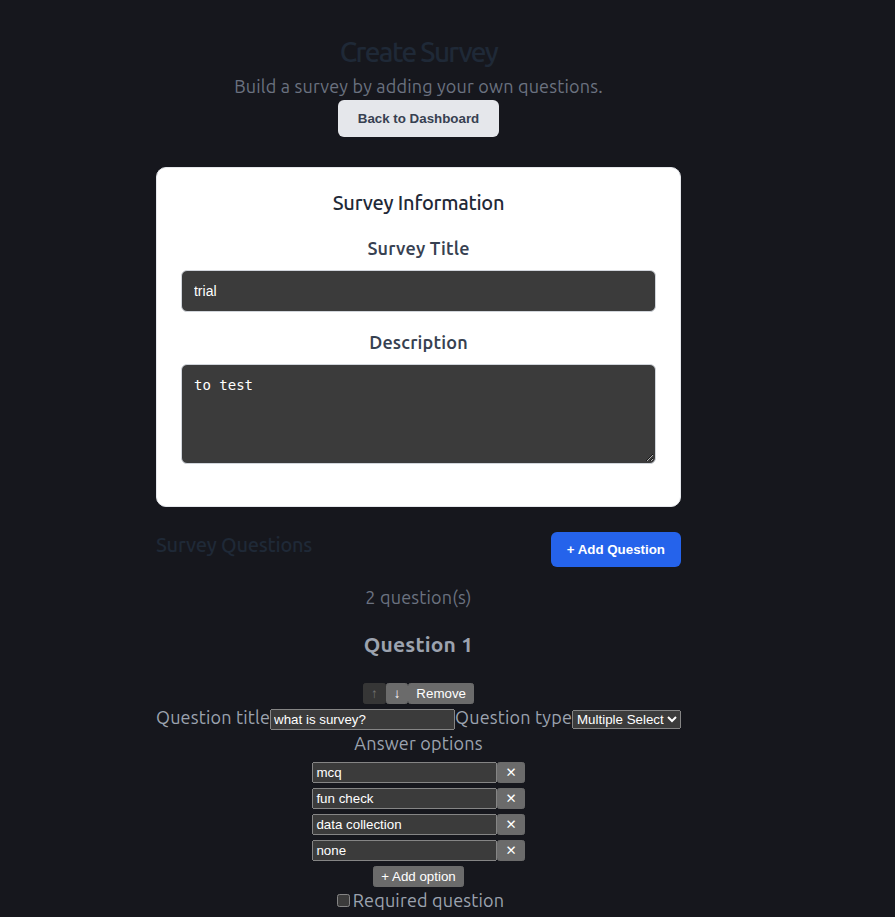
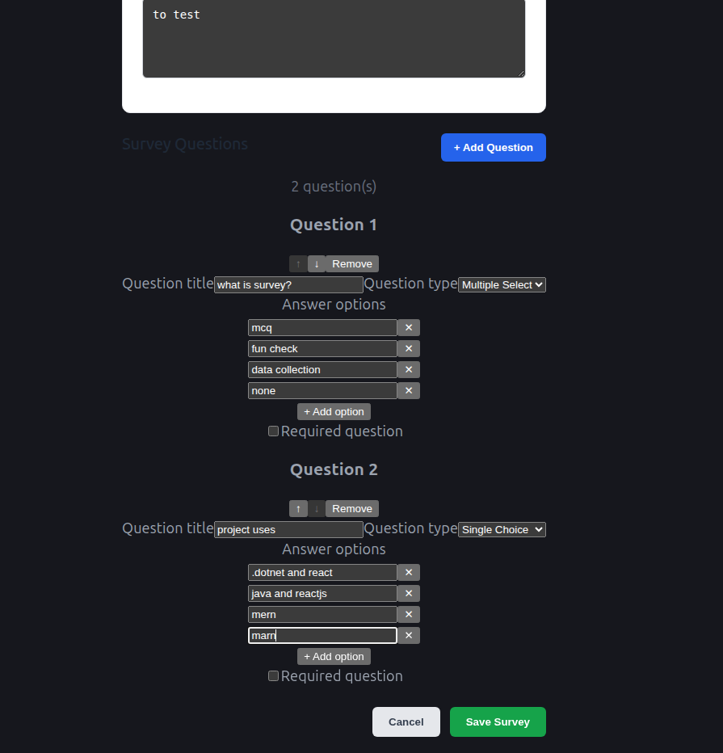
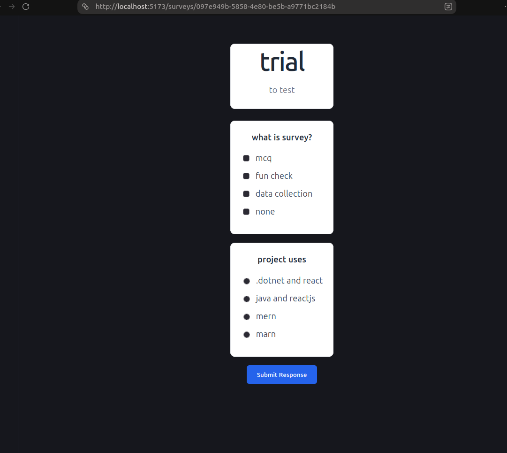
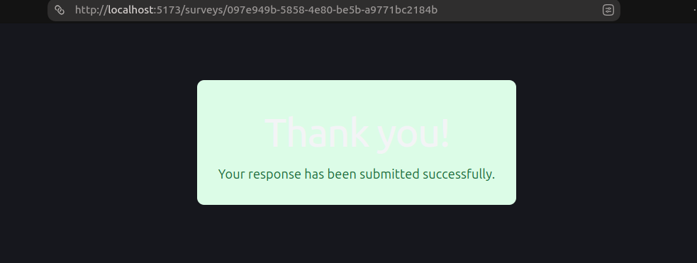
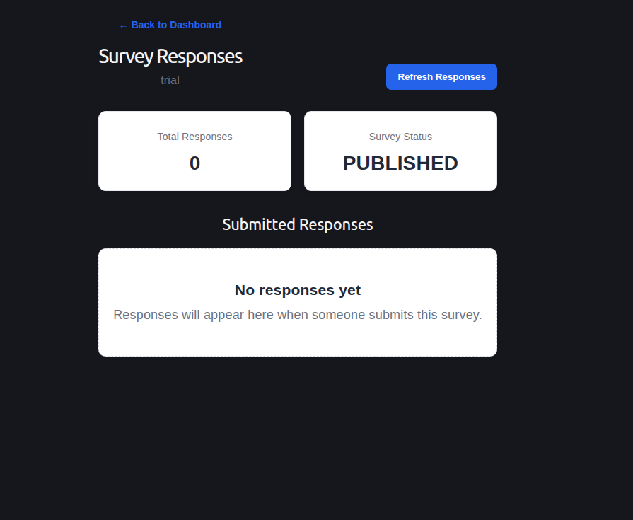
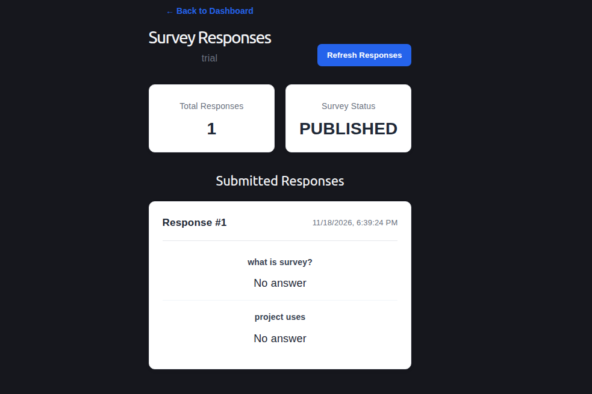
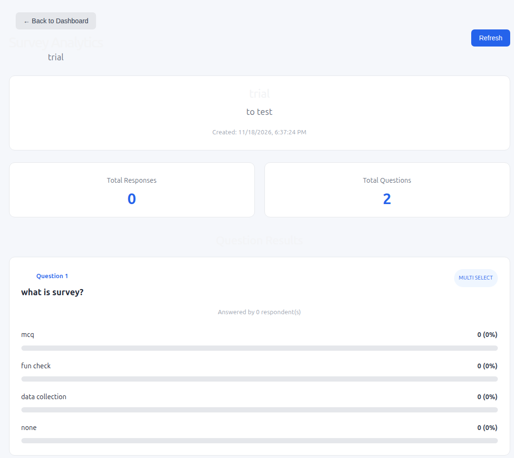
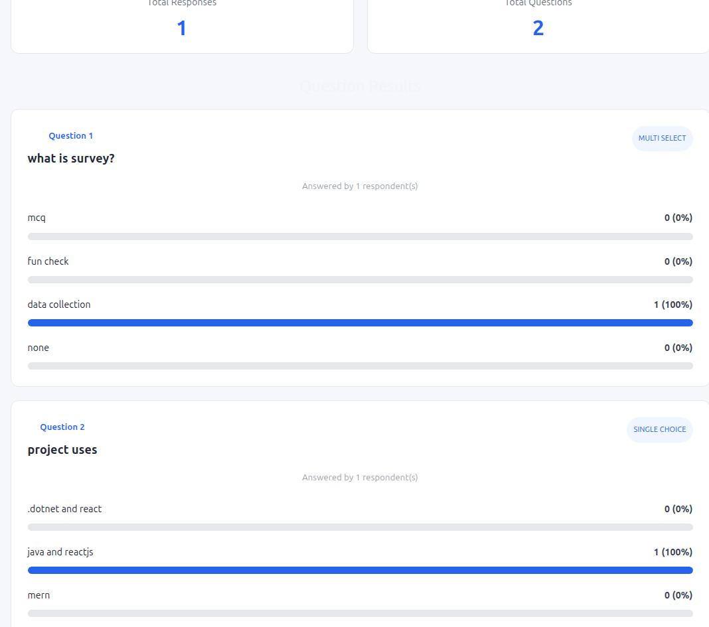

# Survey Management System – UI Screenshots

This document provides a visual walkthrough of the Survey Management System when the application is running. Each section contains a description of the screen, followed by a collapsible screenshot.

Click any **"▼ Show screenshot"** button to expand and view the image.

---

## 1. Dashboard

The Dashboard is the main administration screen. It displays all surveys created by the administrator, along with summary statistics (total, draft, published, and closed surveys). From here, an administrator can create a new survey, publish a draft, close a published survey, delete a survey, copy a shareable link, or navigate to a survey's responses or analytics page.

 Show screenshot

---

## 2. Survey Builder

The Survey Builder allows administrators to create a new survey. Users can enter a title and description, add multiple questions, choose question types (Text, Single Choice, Multi Select, Rating), configure options, mark questions as required, and save the survey to the backend.

 Show screenshot

---

## 3. Question Editor

The Question Editor is a reusable component used within the Survey Builder. It lets the administrator edit an individual question's text, type, required status, and available options.

 Show screenshot

         

---

## 4. Public Survey – Respondent View

The Public Survey page is what respondents see when they open a shared survey link. Questions are rendered according to their configured types: text inputs, radio buttons, checkboxes, and rating selections. Required questions are validated before submission.

 Show screenshot

---

## 5. Survey Submission Confirmation

After a respondent successfully submits a survey, a confirmation message is displayed to acknowledge the submission.

 Show screenshot

---

## 6. Survey Responses

The Survey Responses page allows administrators to view all responses submitted for a particular survey. Each response shows the submission timestamp and the answers mapped to their corresponding questions.

 Show screenshot

       

---

## 7. Survey Analytics

The Survey Analytics page summarizes the collected data for a survey. It shows the total number of responses, per-question breakdowns (option counts for choice questions, average rating for rating questions, and text responses for open-ended questions), along with visual percentage indicators.

 Show screenshot

         

---
